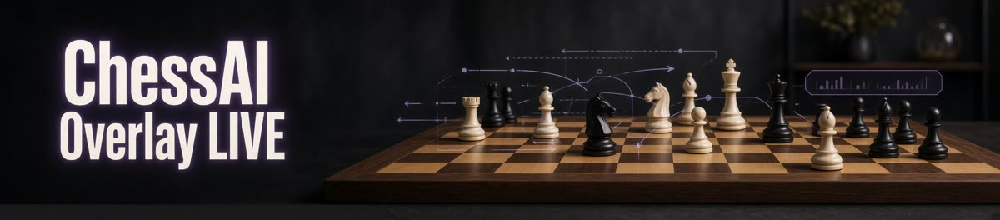
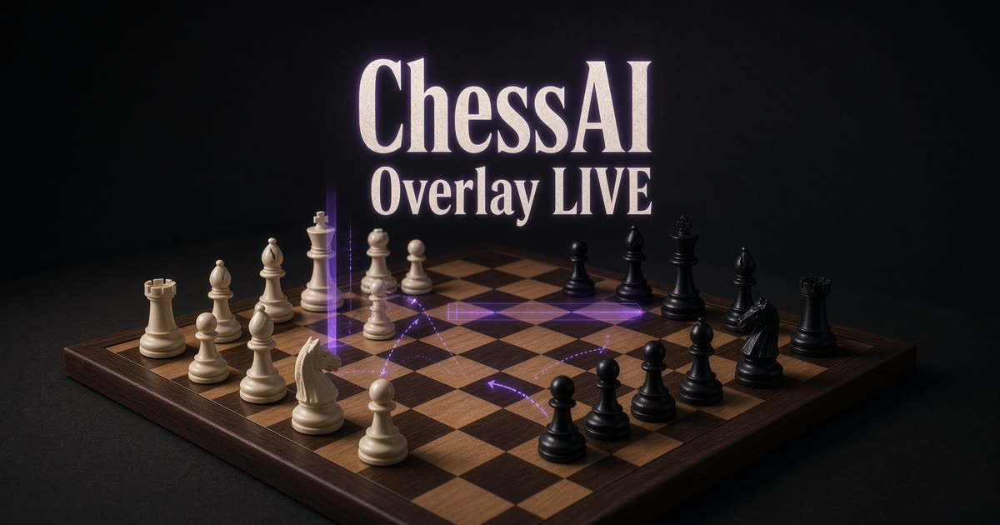

<p align="center">
  
</p>

<h1 align="center">♟️ ChessAI Overlay LIVE</h1>

<p align="center">
  <b>Windows chess companion</b> — always-on-top overlay, live board mirror & optional Stockfish analysis
</p>

<p align="center">
  
  
  
  
  
</p>

<p align="center">
  
</p>

<p align="center">
  
</p>

---

## ✨ What it does

ChessAI Overlay LIVE is a **real desktop app** (not a browser extension).

It sits on top of your game, reads the board from a screen region you select, mirrors the position on an **internal chessboard**, and can run **Stockfish** analysis with evaluation, best move and arrows — for training and authorized games only.

| 🟢 Does | 🔴 Does not |
|--------|-------------|
| Track the live position from screen | Inject scripts into Chess.com / Lichess |
| Show BEST moves on the **in-app board** | Auto-move or click pieces for you |
| Work with browser & desktop chess | Send moves to any server |
| Offer a fair-play **LIVE** mode (engine off) | Encourage cheating in rated games |

---

## 🎯 Features

### 📺 Screen board tracking
- **Select Board Region** — drag over the 8×8 board
- Move detection after the piece is **fully placed** (ignores drag animations)
- Built for **Classic** piece sets (best accuracy)
- **Flip** board orientation (White / Black at bottom)
- **I play: White / Black** — labels the side to move as yours or your opponent's
- Last-move origin and destination highlighted in yellow; the move label identifies whether you or your opponent moved based on **I play**

### 🧩 Internal chessboard
- Live copy of the game inside the app
- **Edit Position** — drag pieces freely; right-click a square to add/remove a piece or set whose turn it is
- Manual piece corrections are retained during resync, so a corrected bishop on a4 will not revert to a pawn
- Last move highlight
- Purple / green **BEST move** arrows animate smoothly onto the internal board
- Move list + side to move

### 🧠 Engine
- Stockfish evaluation (e.g. `+0.36`)
- Best move + top candidate lines
- Adjustable depth & think time
- **Analyze** button — one-time analysis of the current internal board
- **Resync Board** — refreshes the position and requests a fresh one-time analysis
- Async engine so the UI stays responsive
- If Stockfish exits unexpectedly, the app safely restarts it once and retries the current position

### ✨ Compact workspace
- Home, Board, Analysis, and Settings pages in a compact desktop window with an icon-only sidebar and smoothly sliding active-page indicator
- Custom knight startup/app icon, typed welcome, smooth page transitions, and taskbar presence when minimized
- Settings for theme, preset or custom accent colors, image backgrounds with opacity/tint/blur/fit controls, board orientation and coordinates, engine depth/time/lines, window opacity, and always-on-top behavior
- Resize the frameless window from its bottom-right corner; background images and appearance preferences are saved between runs
- Preferences are saved automatically and remain compatible with existing config files

### 🎮 Modes

| Mode | Engine | Best for |
|------|--------|----------|
| **LIVE** | ❌ Automatic hints off; **Analyze** runs once when clicked | Tracking without automatic hints |
| **LIVE ENGINE** | ✅ On | Vs computer, training, allowed analysis |

---

## 🚀 Quick start

### Requirements
- Windows 10 or 11  
- [Python 3.10+](https://www.python.org/downloads/) → enable **Add to PATH**

### Install

```bat
git clone https://github.com/AndreiOradea/ChessAI_Overlay_Live.git
cd ChessAI_Overlay_Live
scripts\setup.bat
```

### Stockfish
1. Download: [stockfishchess.org/download](https://stockfishchess.org/download/)  
2. Put `stockfish*.exe` in a `stockfish\` folder  
3. Restart the app

### Run

```bat
scripts\launch.bat
```

or:

```bat
python main.py
```

### Build the Windows executable

Run `scripts\build_exe.bat`. The onedir build includes the custom knight icon and bundled Stockfish engine; the app is available at `dist\ChessAI_Overlay_LIVE\ChessAI_Overlay_LIVE.exe`.

### First game
1. Chess.com → **Classic** pieces (not Neo)  
2. Start a **new** game from move 1  
3. App → **Reset** → **Select Board Region**  
4. **I play: White** (or Black)  
5. Mode: **LIVE ENGINE**  
6. Move, release the piece, wait ~1 second  

---

## 🛠️ Stack

```text
Python 3.10+ · PySide6 · OpenCV · mss · python-chess · Stockfish (UCI)
```

---

## ⚖️ Fair play

- **LIVE** = tracking only, no engine hints  
- **Analyze** = one-time analysis of the current internal board in either mode
- **LIVE ENGINE** = continuous analysis, only where rules allow it
- No browser injection · no auto-moves · no server input  

Use engine help only in offline / vs-computer / explicitly allowed games.

---

## 🔧 Troubleshooting

| Issue | Fix |
|------|-----|
| Board stuck / wrong | **Reset**, new game from move 1, tighter region |
| Resync is inaccurate | Select only the 8×8 board; templates are learned from the starting position and silhouette matching handles outlined pieces. Resync uses clear yellow last-move squares to infer whose turn is next; ambiguous highlights are not used. Uncertain reads are rejected. Use **Edit Position** to correct a position, then set the side to move. |
| Missed a move | Wait for piece to settle · press **Analyze** |
| Stockfish not found | Place `.exe` in `stockfish\` and restart |
| Bad detection | Use **Classic** pieces on Chess.com |
| App freeze | Close in Task Manager · use latest build |

---

## 📁 Structure

```text
├── main.py
├── favicon.png / og.jpg / x-banner.jpg
├── src/          # UI, recognition, engine, chess logic
├── scripts/      # setup.bat · launch.bat
└── tests/
```

---

## 📄 License

**MIT** — see [LICENSE](LICENSE)  
Stockfish is **GPLv3** (separate license for the engine binary).

---

<p align="center">
  <b>Play smart. Play fair.</b><br/>
  <sub>ChessAI Overlay LIVE · Windows desktop companion</sub>
</p>
